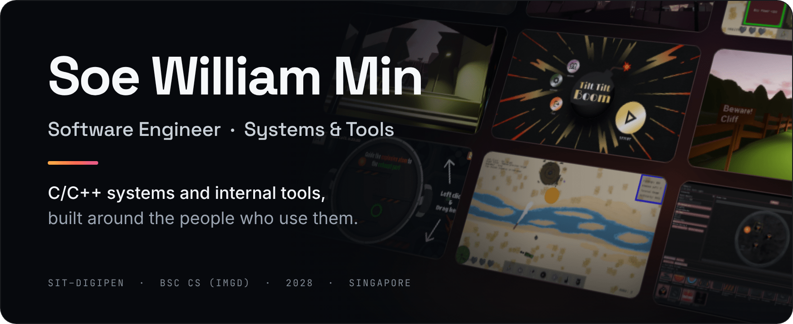
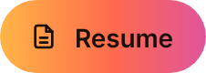
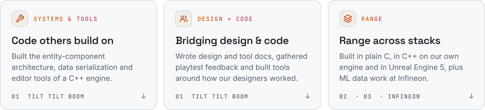
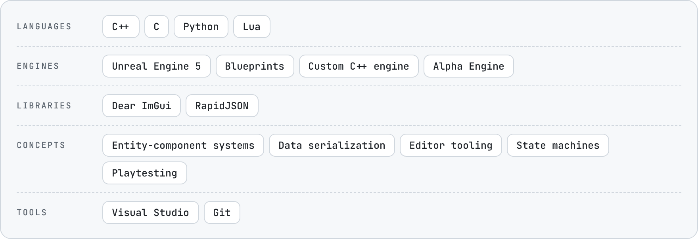
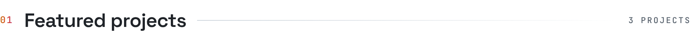
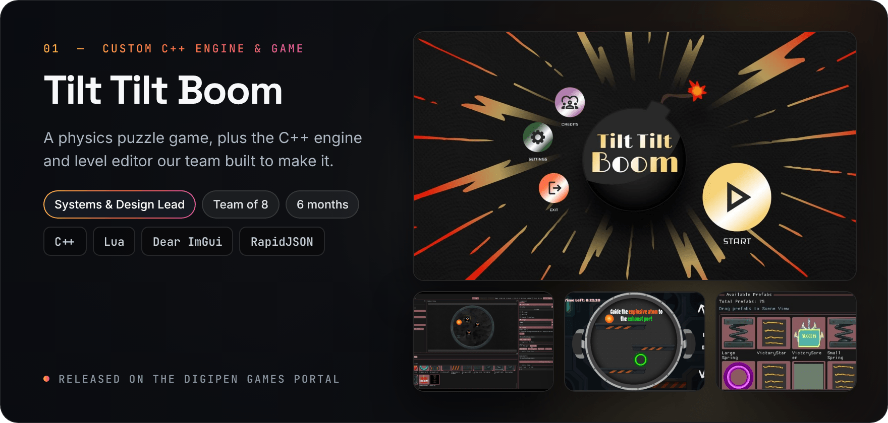
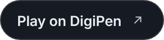
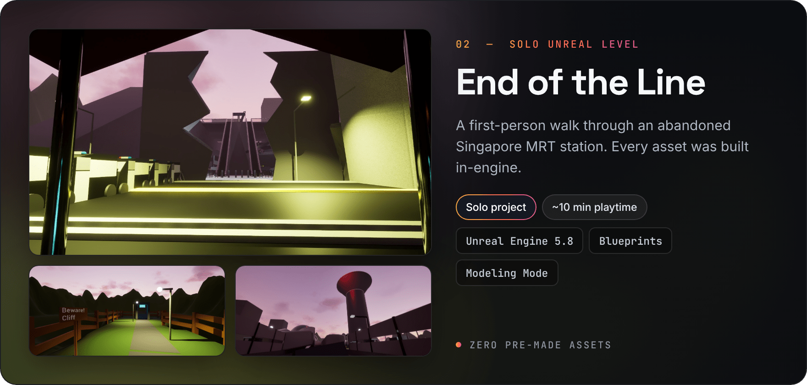
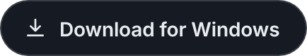
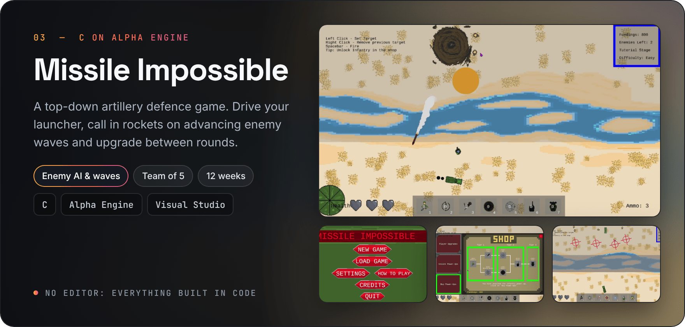

https://github.com/user-attachments/assets/91e2c944-05a2-4cbb-b0f8-f0a4597fc9a7

  &nbsp;
  &nbsp;
  

  <b>Open to a 1-year internship</b> from <b>May 2027</b> &nbsp;·&nbsp; Singapore or overseas 
  Previously AI Development Intern at Infineon Technologies

<picture>
  <source media="(prefers-color-scheme: dark)" srcset="assets/highlights-dark.png">
  
</picture>

<picture>
  <source media="(prefers-color-scheme: dark)" srcset="assets/toolbox-dark.png">
  
</picture>

 

<picture>
  <source media="(prefers-color-scheme: dark)" srcset="assets/h-work-dark.png">
  
</picture>

**What I built**

- **Layered ECS:** designed the engine's entity-component system in data, manager and extension layers behind a single coordinator, with archetypes and an entity factory for spawning prefabs
- **JSON serialization** for components, prefabs, scenes and player progress, and restructured the engine so it can open separate game projects
- **Level editor tools:** a drag-and-drop prefab library (70+ prefabs, from gameplay objects to menus and UI), prefab creation and editing, a properties panel, entity creation and editing, scene save/load and more, built around how our designers worked
- **Design and scripting:** shaped the initial game design (themes, backstory, gameplay elements) and wrote Lua gameplay and UI scripts: teleporters, collision interactions, menu transitions

**Tech:** C++ · Lua · Dear ImGui · RapidJSON · custom engine

<picture><source media="(prefers-color-scheme: dark)" srcset="assets/btn-contributions.png"></picture>

 

https://github.com/user-attachments/assets/4ee8a07c-c885-457f-bb34-82c5360c8e2a

<picture><source media="(prefers-color-scheme: dark)" srcset="assets/btn-editor-showcase.png"></picture>

 

https://github.com/user-attachments/assets/630dbda8-0db1-4f9a-bfb4-17c2a0678380

 

**What I built**

- **Blueprint systems** (Unreal's visual scripting): elevator, trigger and key-based teleports, zone-based audio with BGM switching, level loading
- **No pre-made assets:** all geometry built in-engine, mainly with Modeling Mode (Boolean cuts, scattered debris, kitbashed props), plus the Landscape tool for terrain

**Tech:** Unreal Engine 5.8 · Blueprints · Modeling Mode · Landscape 
Made on exchange at DigiPen in Redmond, USA.

 

**What I built**

- **State-based enemy AI:** infantry that advance on the fog line, scatter from incoming blasts and shoot when in range; launchers that move into firing range, panic when a rocket lands nearby, and fire back
- **Wave manager:** spawning, wave state and transitions, with enemy counts growing each wave and an end screen after the final wave
- **Rockets and firing:** rocket spawning and a fake 3D arc in a top-down view (scaled up and down to suggest height, then into an explosion), range-limited firing for the player's tank and enemy launchers, and craters that slow enemies down
- **Team process:** worked from a shared task backlog with hour estimates and weekly progress meetings; took part in playtesting and wrote up user feedback; integrated art assets and fixed bugs

**Tech:** C · Alpha Engine · Visual Studio

<picture><source media="(prefers-color-scheme: dark)" srcset="assets/btn-watch.png"></picture>

 

https://github.com/user-attachments/assets/a09120cf-7aa1-4218-80bd-83afa378c360

